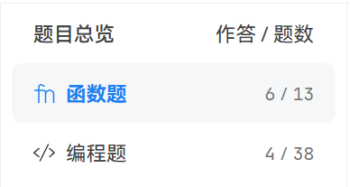
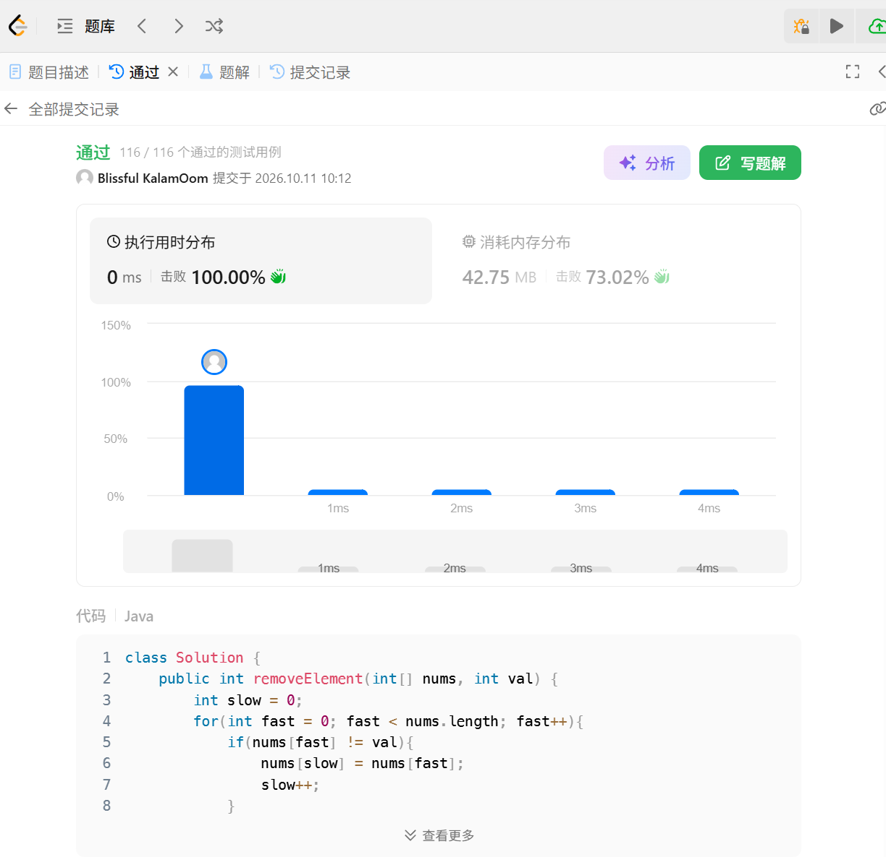

# 宠物店考核作业

作业要求：[Java & Android 第一轮考核](../README.md)。提交者：`sonata36`。

使用 Java 17 编写的宠物店示例，包含动物抽象类、中华田园犬、猫、兔子、顾客、宠物店接口与实现，以及两种业务异常。

## 在线练习截图

PTA 题目总览（函数题 6/13，编程题 4/38）：



力扣第 27 题「移除元素」通过记录：



## 自己动手测试

在项目根目录打开 PowerShell，编译后运行交互入口：

```powershell
New-Item -ItemType Directory -Force out | Out-Null
javac -encoding UTF-8 -d out (Get-ChildItem -Recurse src -Filter *.java).FullName
java '-Dfile.encoding=UTF-8' -cp out com.sonata36.petshop.PetShopConsole
```

启动时输入第一天的开店余额，然后按照菜单进货、招待顾客、查看库存与利润、歇业。进货时用 `1` / `2` 选择公或母，还要输入低于固定售价的成本价；招待顾客时会列出库存，用编号选择要出售的宠物。歇业后选择进货、招待顾客或再次歇业，会立即提示操作失败，无需继续输入。歇业后选 `5` 进入下一营业日，无需再次输入余额：自动继承前一天的余额、库存和顾客记录，当日利润重新计算。想验证余额不足，可在第一天用 50 元开店，买入售价 100 元的狗时输入成本价 60 元；想验证缺货，可在库存为空时招待顾客。重复输入同一顾客名字可检查到店次数是否累计。输入 `0` 退出；输入不是有效数字时会提示重新输入。

如果使用 IntelliJ IDEA，也可以将 `src` 标记为 Sources Root，直接运行 `PetShopConsole.main()`。

## 固定功能检查

完成上面的编译后，在 PowerShell 中执行：

```powershell
java '-Dfile.encoding=UTF-8' -cp out com.sonata36.petshop.Test
```

`Test` 会演示进货、销售、缺货、余额不足和歇业，并在检查通过后输出“所有测试通过”。

## 业务约定

- 控制台允许顾客选购指定动物；直接调用 `serveCustomer(customer)` 时默认售出最先入库的动物。中华田园犬售价 100 元，猫售价 200 元，兔子售价 80 元。
- 顾客每次到店都会增加到店次数并留下独立记录，即使当时没有库存。歇业时只输出当日到店记录。
- 进货成本价最多保留两位小数，并且必须低于动物售价。余额按成本价扣除，售出时按固定售价入账；当日利润 = 当日销售额 − 当日买入成本。构造时提供的初始库存和余额属于开店前状态，不计入当日利润。
- 歇业后，进货、招待顾客或再次歇业会抛出 `IllegalStateException`；控制台会立即提示“操作失败：宠物店已经歇业”。营业期间库存为空时，招待顾客会抛出 `AnimalNotFoundException`。题目第 8 条将 `Found` 误写为 `Fount`；项目保留 `AnimalNotFountException` 作为兼容父类，`AnimalNotFoundException` 继承它。
