# (Java) 2026 第一轮


### 文件目录概览：

```
measure666
	├─DWASearch       (离线查询工具)
    ├─image
    ├─JsonFetcher     (抓取脚本)
    ├─input.txt       (现成的命令文件)
    └─README.md       (当前文件)
```


### 1. 环境版本：

|       组件       |    版本     |
| :--------------: | :---------: |
|   Java ( JDK )   | 17.0.20 LTS |
|      Maven       |   3.9.14    |
| jackson-databind |   2.18.2    |
|  junit-jupiter   |   5.10.2    |


### 2. 构建、运行和测试命令：

**2.1 下载项目：**

```bash
git clone https://github.com/measure666/collection-java.git
```

**2.2 进入DWASearch并构建打包：**

```bash
cd work2/measure666/DWASearch
mvn package
```

**2.3 运行程序：**

```bash
cd target
java -jar DWASearch.jar input.txt output.txt
```

os:  运行前可先在 work2/measure66/DWASearch/target 中直接创建 input.txt 并通过 Windows 自带记事本打开输入命令或使用 bash 指令创建(以下为举例)：

```bash
cd target
echo players>input.txt
```

或直接拷贝 [work2/measure666/input.txt](./input.txt) (含现成的测试指令) 至  [work2/measure666/DWASearch/target](./DWASearch/target) 中

**结果输出在 output.txt 中 ( work2/measure66/DWASearch/target )**

也可将DWASearch.jar放到其它目录，只要保证与 input.txt 在同一目录即可


### 3. 数据来源：

**3.1 打开链接** [**World Aquatics Diving World Cup 2026 - Super Final（北京）**](https://www.worldaquatics.com/competitions/5019/world-aquatics-diving-world-cup-2026-super-final)

按F12后：

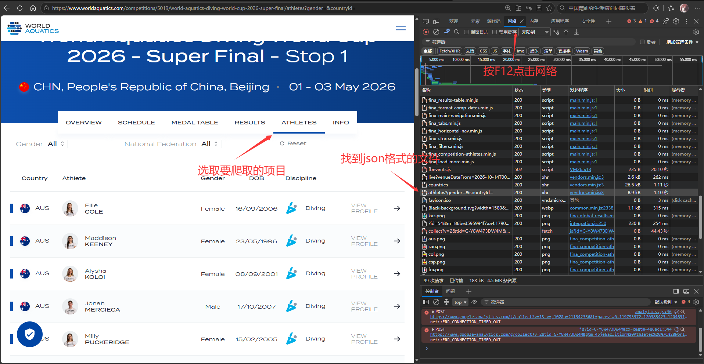

**3.2 复制URL：**

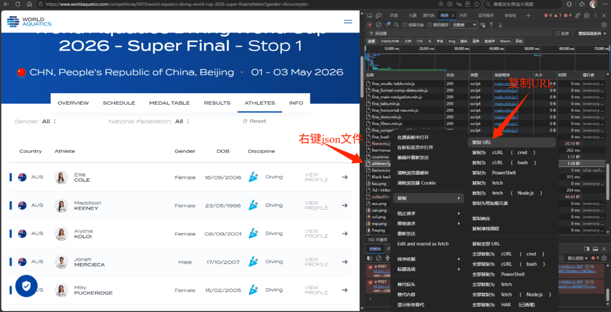

**3.3 获得以下URL:**

```java
https://api.worldaquatics.com/fina/competitions/5019/athletes?gender=&countryId="
https://api.worldaquatics.com/fina/events/4c18d241-ad14-436a-bd38-25dfb47f1cb7"
https://api.worldaquatics.com/fina/events/08d17e1c-94c2-4c56-bf2b-603eeba24f8c"
https://api.worldaquatics.com/fina/events/450a9e84-5db0-40c4-a45c-4c3bb2392f48"
https://api.worldaquatics.com/fina/events/f86bd80d-a342-40f7-a521-90a50ad9d5c5"
https://api.worldaquatics.com/fina/events/2b08da89-8232-4ffc-8df3-95865ba41b82"
https://api.worldaquatics.com/fina/events/61b483ec-4022-4555-9960-fba9cd1d702d"
https://api.worldaquatics.com/fina/events/581a26af-8e97-427c-9adb-5fdd8f4fc9c1"
https://api.worldaquatics.com/fina/events/c3cca7c9-5ef7-4a69-a173-82fe75ffcc4b"
```

**抓取时间：(2026/10/15)运行DWASearch前**


### **4. 通过脚本抓取选手和决赛结果的json数据：**

通过简单的代码实现抓取

脚本 [JsonFetcher](./JsonFetcher)

```java
private static final Map<String, String> ENDPOINTS = new LinkedHashMap<>(); //利用 Map 集合存 <赛事名,url链接>
private static final int MAX_RETRIES = 3;                   // 失败最多重试 3 次
private static final long DELAY_BETWEEN_REQUESTS_MS = 800;   // 请求间隔，控制频率
```

代码实现：

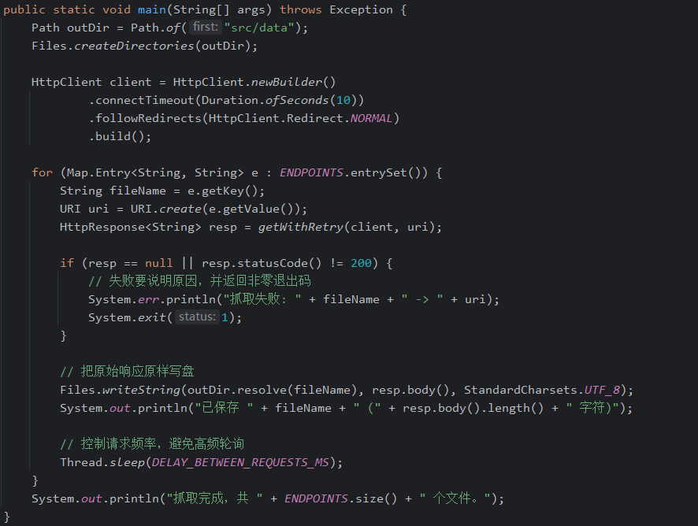

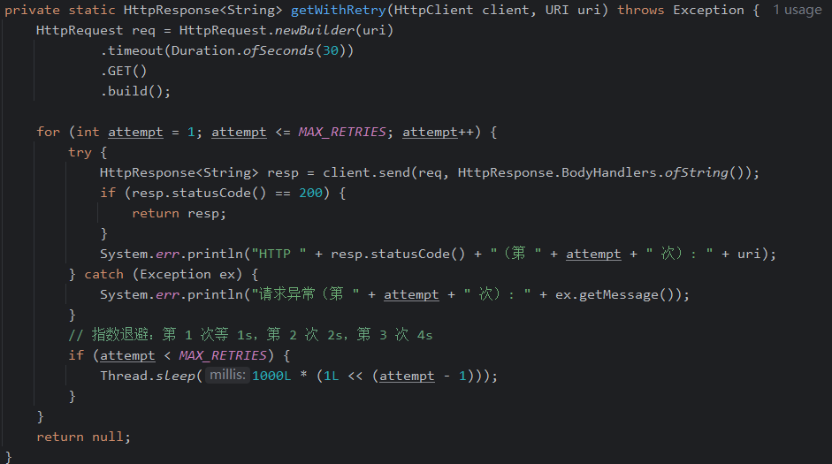

**4.1 编译运行脚本:**

可以通过 idea 等 ide 编译器直接打开脚本运行或通过命令行：

```bash
cd work2/measure666/JsonFetcher
javac -encoding UTF-8 -d out src/JsonFetcher.java
java -cp out JsonFetcher
```

抓取到的数据在 [src/data](work2/measure666/JsonFetcher/src/data)中:

```
│
├─out
│      JsonFetcher.class
└─src
    ├─JsonFetcher.java
    │
    └─data─-athletes.json
           ├─men 10m platform.json
           ├─men 10m synchronised.json
           ├─men 3m springboard.json
           ├─men 3m synchronised.json
           ├─women 10m platform.json
           ├─women 10m synchronised.json
           ├─women 3m springboard.json
           └─women 3m synchronised.json
```

将 json 数据拷贝到  [work2/measure66/DWASearch/src/main/resources](work2/measure66/DWASearch/src/main/resources) 供DWASearch直接使用


### 5. 定义的json格式:

**选手json:**

```json
{
    {
        "CountryName": "XXX",
        "Participations":[
            {
                "Gender": 0/1,
                "PreferredLastName": "xxx",
                "PreferredFirstName": "xxx",
            },
        	...
        	{
            	"Gender": 0/1
            	"PreferredLastName": "xxx",
            	"PreferredFirstName": "xxx",
        	}
    	],
	},
	...
}
```

**决赛数据json：**

```json
{
    "Heats":[
        {
            "Name": "Finals",
            "Results": [
              {
                  "TotalPoints": "xxx",
                  "Rank:": 1/2/3/4,
                  "FullName": "xxx" //双人 "FullName": "xxx/xxx")
                  "Dives":[
                      {
                  			"DivePoints": "xxx",
                      }
                  ]
              },
        	  ...
            ],
        }
    ],
}
```

**通过导入 JackSon 依赖将 JSON 解析成对象**


### 6. 完成的功能：

部分代码与接口设计参考了仓库 [LunaY77/DWASearch](https://github.com/LunaY77/DWASearch)

#### 6.1 前期准备：

**6.1.1 处理输入输出模块**

使用 Utility 类 封装输入输出

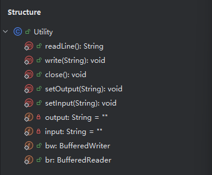


**6.1.2 JavaBean 模块**

根据 5. 定义的 json 格式，构造相应的 JavaBean 类

1): Athlete类，实现基本 getter、setter、constructor、toString方法

该类代表运动员基本信息

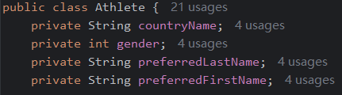


2): Contest类，实现基本 getter、setter、constructor、toString方法

该类代表每位运动员单个项目单场比赛结果

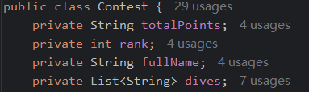


#### 6.2 接口设计：

**CoreModule：**

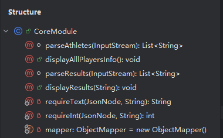

**6.2.1 实现的功能：**

1）查询所有 参赛选手 的信息

构造以下方法：

```java
//利用 JackSon 依赖 解析 athlete.json 并排序返回 List 数组
List<String> parseAthletes(InputStream in){}
```

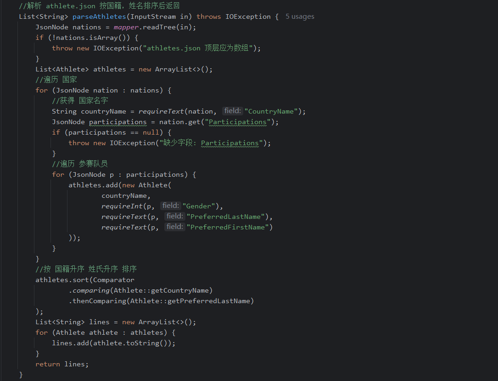


```java
//将解析并排序的 List 数组 通过 Utility 工具类 写入文件
public void displayAllPlayersInfo(){}
```

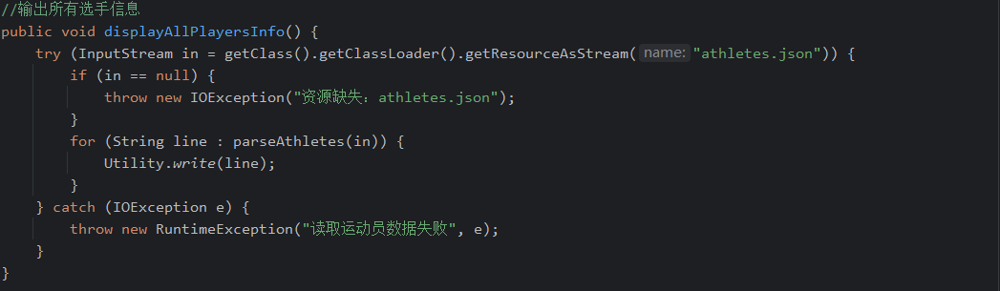


2）查询 决赛结果

```java
//利用 JackSon 依赖 解析 赛事结果json 并排序返回 List 数组
List<String> parseResults(InputStream in){}
```

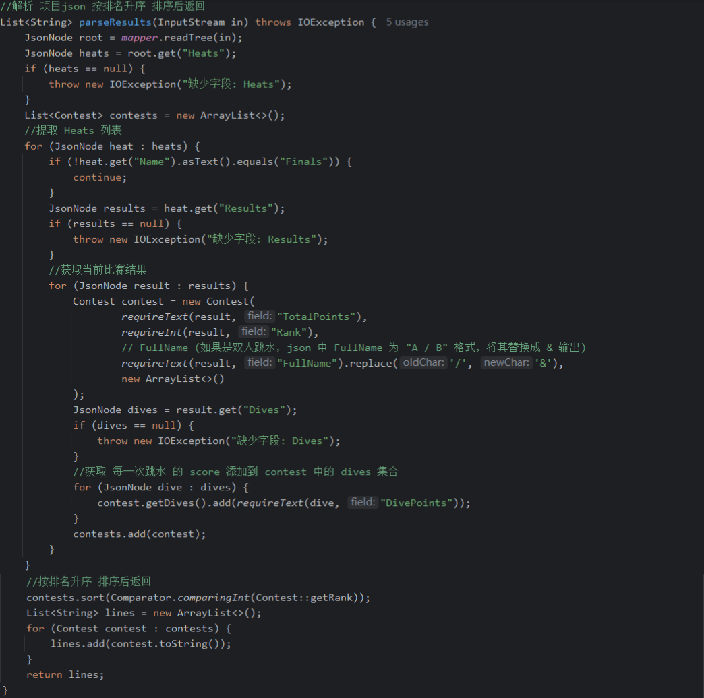


```java
//将解析并排序的 List 数组 通过 Utility 工具类 写入文件
public void displayResults(String contestName){}
```

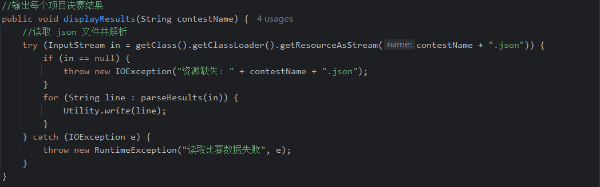


**6.2.2 利用 JackSon 解析 json: **

通过  JackSon 的 JsonNode 树模型 API 直接操作 JSON 节点 分别读取数据：

```java
//创建 ObjectMapper 实例
private static final ObjectMapper mapper = new ObjectMapper();

//创建跟节点,放在每个解析方法中
JsonNode root = mapper.readTree(in);//通过 io流 读取 json 文件

//利用 JsonNode 的 get 方法解析成相应数据 同时判断是否缺少字段
//将数据转换为 字符串 Sring 类 以便写入
private static String requireText(JsonNode node, String field) throws IOException {
    JsonNode v = node.get(field);
    if (v == null || v.isNull()) {
        throw new IOException("缺少字段: " + field);
    }
    return v.asText();
}
//将数据转换为 int 以便写入
private static int requireInt(JsonNode node, String field) throws IOException 			JsonNode v = node.get(field);
    if (v == null || v.isNull()) {
        throw new IOException("缺少字段: " + field);
    }
    return v.asInt();
}
```

#### **6.3 DWASearch 类**

**6.3.1 通过正则表达式判断命令正误:**

```java
public static final Pattern REGEX_PLAYERS = Pattern.compile("^players$");
public static final Pattern REGEX_CONTEST = Pattern.compile(
    "^result (men 3m springboard|
    men 3m synchronised|
    men 10m platform|
    men 10m synchronised|
    women 3m springboard|
    women 3m synchronised|
    women 10m platform|
    women 10m synchronised)$"
    );
public static final Pattern REGEX_RESULT = Pattern.compile("^result( |$)");
```

**6.3.2 通过构建 run() 方法判断是否正常实现指令：**

正常返回 0

异常返回 非0 (参数数量错误、输入文件不存在、输出文件不可写、处理失败等情况)

```java
public static int run(String[] args) {
    // 1. 参数数量校验
    if (args.length != 2) {
        System.err.println("用法: java -jar DWASearch.jar <输入文件> <输出文件>");
        return 1;
    }
    try {
        // 2. 输入文件校验
        try {
            	Utility.setInput(args[0]);
        } catch (FileNotFoundException e) {
           	System.err.println("错误: 输入文件不存在或无法读取: " + args[0]);
           	return 1;
        }

        // 3. 输出文件校验（目录不存在 / 不可写时在此失败）
        try {
            Utility.setOutput(args[1]);
        } catch (IOException e) {
            System.err.println("错误: 输出文件不可写: " + args[1]);
            return 1;
        }
        // 4. 逐行处理命令
        CoreModule coreModule = new CoreModule();
        String line;
        while ((line = Utility.readLine()) != null) {
            Matcher playerMatcher = REGEX_PLAYERS.matcher(line);
            Matcher resultMatcher = REGEX_RESULT.matcher(line);
            Matcher contestMatcher = REGEX_CONTEST.matcher(line);

            if (playerMatcher.find()) {
                coreModule.displayAllPlayersInfo();
                continue;
            }
            if (resultMatcher.find()) {
                if (contestMatcher.find()) {
                    coreModule.displayResults(contestMatcher.group(1));
                } else {
                    Utility.write("N/A\n" + "-----");
                }
            } else {
                Utility.write("Error\n" + "-----");
            }
        }
        return 0;
    } catch (IOException | RuntimeException e) {
        // 数据损坏、缺少字段等“明确失败” 返回非零退出码
        System.err.println("处理失败: " + e.getMessage());
        return 1;
    } finally {
        try {
            Utility.close();
        } catch (IOException ignored) {
    	}
 	}
}
```


**6.3.3 main 函数：**

```java
public static void main(String[] args) {
        System.exit(run(args));
}
```


### **7. 空行处理和已知限制：**

| 输入                        | 输出            |
| --------------------------- | --------------- |
| 空行(" ")                   | Error\n-----\n  |
| 空文件                      | 不输出，退出码0 |
| players          (尾随空格) | Error\n-----\n  |
| result (无项目)             | N/A\n-----\n    |
| Plyers/RESULT(大小写不对)   | Error\n-----\n  |

同时，输入的命令中 **比赛项目** 名字必须严格按照 json 文件的名字：

```
result men 10m platform
result men 10m synchronised
result men 3m springboard
result men 3m synchronised
result women 10m platform
result women 10m synchronised
result women 3m springboard
result women 3m synchronised
```


### 8.单元测试

可直接通过

```bash
mvn test
```

**8.1 实现测试:**

4 个测试类，共 43 条自动化测试，覆盖题目要求的主要行为：

| 测试类                 | 覆盖行为                                                     |
| ---------------------- | ------------------------------------------------------------ |
| `domain/DomainTest`    | `Athlete`/`Contest` 的 `toString`、`getScore` 纯逻辑与边界：各跳成绩 `+` 拼接、双人姓名 `/`→`&`、两位小数、`-----` 分隔线 |
| `core/CoreModuleTest`  | ① 选手/成绩查询 vs 本地 JSON 快照  ② 排序（选手按国籍+姓氏升序、成绩按排名升序，用乱序 JSON 验证） ③ 数据读取失败（损坏 JSON、缺 `CountryName`/`TotalPoints`/`Dives`、顶层非数组、缺资源、无 `Finals` 场） |
| `DWASearchCommandTest` | ① 命令处理（未知命令→`Error`、`result` 无空格→`Error`、缺失/错误项目名→`N/A`、多余字符→`N/A`、重复命令每次输出、多行 `players`+`result`）；② 边界与格式（空文件无输出、空行→`Error`、大小写→`Error`、多余空格、`-----` 分隔、`\n` 换行）；③ 错误后继续（非法/`N/A` 后接合法命令都按规则输出） |
| `DWASearchEntryTest`   | 程序入口与文件错误：0/1/3 个参数→非零退出码、错误信息走 stderr、输入文件不存在→非零、输出不可写→非零、合法参数→0、真实打包 jar 读写 |

**8.2 主要故障处理：**

| 故障类型                                  | 处理方式                                                     |
| ----------------------------------------- | ------------------------------------------------------------ |
| 未知/非法命令、空行、大小写错误、多余空格 | 输出 `Error\n-----\n`（或 `N/A\n-----\n`），继续处理后续命令，进程退出码仍为 0 |
| 参数个数 ≠ 2                              | stderr 打印用法，退出码 1                                    |
| 输入文件打不开（`FileNotFoundException`） | stderr「错误: 输入文件不存在或无法读取」，退出码 1           |
| 输出文件不可写（`IOException`）           | stderr「错误: 输出文件不可写」，退出码 1                     |
| JSON 损坏 / 缺必要字段 / 资源缺失         | 抛 `IOException`/`RuntimeException` → 主流程 catch → stderr「处理失败: …」，退出码 1 |
| 任意一步失败                              | `finally` 中 `Utility.close()` 关闭读写流                    |
