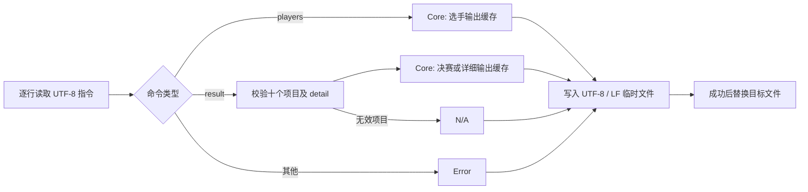
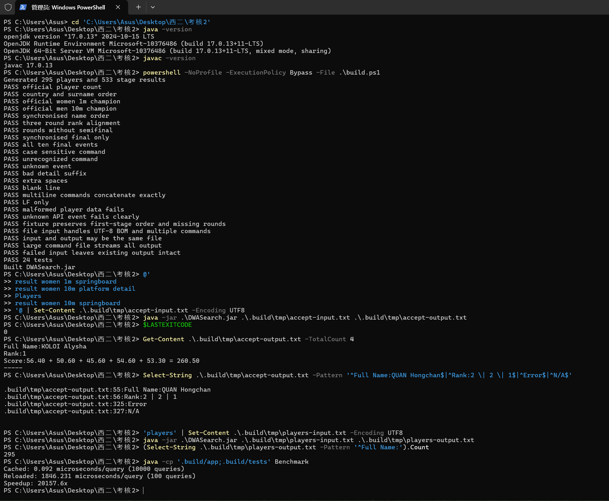

# DWASearch：2024 多哈世界游泳锦标赛跳水成绩查询

本项目按课程任务要求实现离线控制台程序。数据来自 [World Aquatics 的多哈 2024 赛事页面](https://www.worldaquatics.com/competitions/2969/world-aquatics-championships-doha-2024/results) 和其官方计时服务 [OMEGA 跳水成绩页](https://www.omegatiming.com/2024/world-aquatics-championships-div-live-results)。本仓库保存了 OMEGA 的报名名单及各轮 *Detailed Results* PDF 文本摘录。原始 PDF 链接位于 `src/data/raw/` 各文件首行，数据仅用于本课程作业。

> 作业要求：[Java 第二轮考核](../README.md)。提交者：`sonata36`。题目中的 MULLER Jette 获得女子 1m 冠军只是格式示例；2024 多哈站该项目的实际冠军是 KOLOI Alysha。项目以官方 2024 成绩为准。

课程提供的[往届作业参考页](https://blog.csdn.net/CowBoyHS/article/details/129327279)可用于了解数据收集思路。本项目的结果数据、输出格式和校验以本仓库保存的官方 OMEGA 资料及本届任务要求为准。

## 运行

需要 JDK 17 或更新版本。仓库根目录已有可运行的 `DWASearch.jar`。准备 UTF-8 编码的 `input.txt`，每行一条指令，然后运行：

```powershell
java -jar DWASearch.jar input.txt output.txt
```

例如：

```text
players
result women 1m springboard
result women 10m platform detail
```

程序按输入顺序将所有结果写到 `output.txt`，使用 UTF-8 与 LF 换行，每条记录以独立的 `-----` 行结尾。`players` 按英文国家名、选手姓氏升序排列；`result` 默认返回决赛，添加 `detail` 返回初赛、半决赛与决赛并用 `*` 标出未举行或未参加的轮次。双人项目使用按姓氏排序的 `A & B` 姓名形式。项目名称与命令大小写敏感，只接受题目规定的十个项目。无法识别的命令输出 `Error`；`result` 后项目名或后缀错误输出 `N/A`，两者也都附分隔线。

缺少输入或输出路径时，程序向标准错误输出用法并以状态码 2 退出；文件读取、写入或数据加载失败时以状态码 1 退出。程序逐行读取命令并写入输出目录中的临时文件，成功后才替换目标文件。因此可将输入和输出设为同一路径，读取失败也不会覆盖已有输出。运行时完全离线，不请求官网。

## 项目结构与数据收集

```text
src/DWASearch.java       命令行入口；逐行解析与输出
src/CoreModule.java      可复用的查询 API 与内存索引
src/Lib.java             格式化工具
src/data/raw/            21 份 OMEGA PDF 文本摘录（首行保留源链接）
src/data/players.tsv     选手表
src/data/results.tsv     分轮成绩表
tools/GenerateData.java  原始 PDF 文本到 TSV 的提取与校验
tests/DWASearchTest.java  24 个回归测试
tests/Benchmark.java     Core 模块性能基准
build.ps1                数据生成、编译、测试与 JAR 打包
DWASearch.jar            可直接运行的 JAR
```

OMEGA 的 [报名名单 PDF](https://www.omegatiming.com/File/0001180100FFFFFFFFFFFFFFFFFFFF02.pdf) 提供姓名、性别和国家代码。赛事页列出十个目标项目的每场初赛、半决赛、决赛；各 PDF 的逐跳得分与总分被归一化为 TSV。仓库保留 295 名报名选手、533 条分轮成绩记录。原始摘录中的国家代码转为英文国家名，姓名统一引用报名名单；PDF 结果表中的无变音符号拼写与名单进行规范化匹配。选手名单采用官方报名名单，故包含只参加混合项目或团队项目的报名选手；`result` 仅覆盖题目指定的十个项目。

`GenerateData` 对每条结果进行逐跳分数求和校验，并核对结果表中的国家代码与报名选手所属国家是否一致（双人项目核对两名选手）。它还检查姓名和项目。对已有部分得分但最终退赛、无官方名次的选手，名次记录为 `*`；尚未产生得分的退赛者不进入成绩表，但仍可出现在报名名单。原始摘录按 PDF 生成，复现表格可在仓库根目录执行：

```powershell
javac -encoding UTF-8 -d .build/tools tools/GenerateData.java
java -cp .build/tools GenerateData
```

日常构建建议直接运行 `build.ps1`，它会自动完成这些步骤。

## Core 模块接口与算法

`CoreModule.fromBundledData()` 从 JAR 中加载两份 TSV 一次，构造完整的选手输出、各项目决赛输出、各项目详细输出。外部调用 `displayAllPlayersInfo()` 或 `displayResultsForEachEvent(event, detail)` 即可取得 UTF-8 文本内容；`supportedEvents()` 与 `supportsEvent(event)` 用于参数校验。构造器也接受两个 `InputStream`，方便替换数据源与测试。

成绩表按项目和轮次分组，使用保留插入顺序的映射按选手姓名合并三轮记录。若存在初赛，详细输出沿初赛排名的原始顺序；只有决赛的双人项目沿决赛顺序。缺席轮次预设为 `*`，有实际成绩时再填入对应名次和分数。输出格式在 `Lib` 中集中管理，防止各命令产生不同的空格或换行。



数据文件结构错误、项目缺少决赛、文件路径无效等会抛出明确异常。CLI 将 I/O 与参数错误写到标准错误流；输入文件中的非法指令作为正常输出中的 `Error` 或 `N/A` 处理。对未知项目直接调用 Core API 则抛出 `IllegalArgumentException`，避免把调用方错误伪装为空结果。

## 构建、单元测试与运行验证

在 Windows PowerShell 中运行：

```powershell
powershell -NoProfile -ExecutionPolicy Bypass -File .\build.ps1
```

脚本会重新生成数据、编译 Java、运行 24 个独立回归用例，然后打包 `DWASearch.jar`。测试覆盖官方冠军与分数、选手数量和顺序、双人姓名、三轮名次对齐、无半决赛项目、仅有决赛的项目、十个项目全部可查询、大小写和无效项目、多行拼接、LF 换行、错误数据与 Core API 异常，以及自造数据中的晋级缺席情况。文件级测试覆盖 UTF-8 BOM、输入输出同路径、20,000 行命令和失败时保留旧输出。无需 Maven 或外部测试依赖。

本机验证：JDK 17；构建通过 24/24 个测试；使用 `java -jar DWASearch.jar` 对多行输入进行了完整运行，输出成功生成。

命令行构建、结果查询和性能测试的实际运行截图：



## 性能分析与改进

朴素实现每处理一条指令都重新读取并解析两张 TSV 表，重复查询的开销随指令数线性累积。当前实现构造 `CoreModule` 一次，将已排版的 21 类输出（选手列表及十项赛事各自的决赛、详情）存入内存；每条查询只做命令校验和映射读取。加载阶段复杂度约为 `O(P + R)`，`P` 为选手数、`R` 为分轮记录数；结果构造中的哈希映射合并平均为 `O(R)`。CLI 逐行读写，处理大量命令时不再按输入行数或输出总长度积累内存；其额外内存主要由 Core 缓存、一条命令和写入缓冲决定。输出文件的实际写入仍与输出长度成正比。

运行 `java -cp '.build/app;.build/tests' Benchmark` 的一次本机测量：重复查询女子 10m 详情时，缓存查询为约 **0.145 µs/次**（10,000 次），每次重新加载数据为约 **8,765.527 µs/次**（100 次），约 **60,569 倍**。该基准仅比较 Core 查询路径，包含重新加载方案的解析和排版成本，不包含 JVM 启动与输出文件写入；不同机器与运行环境会得到不同数值。
